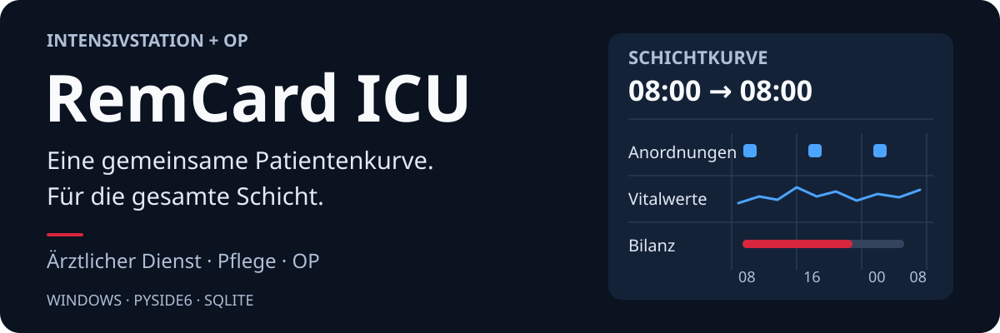
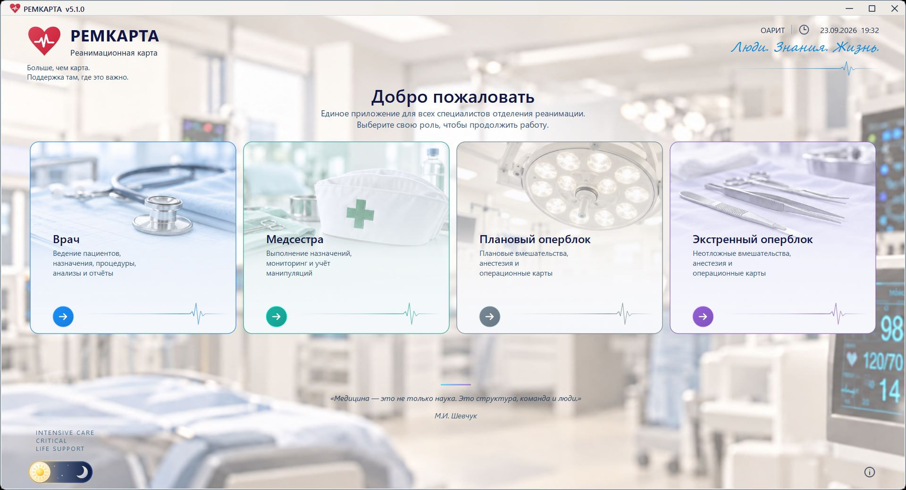
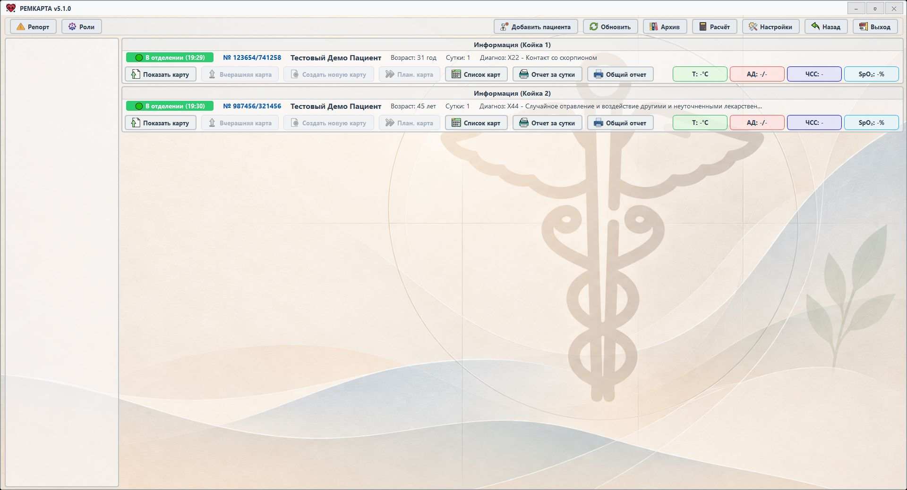
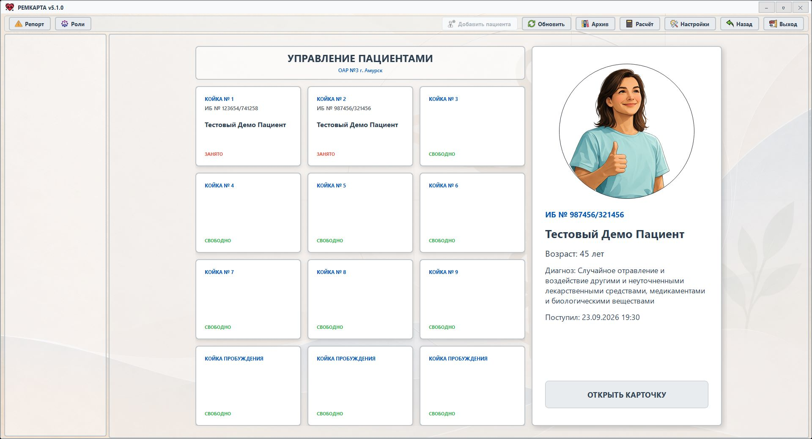
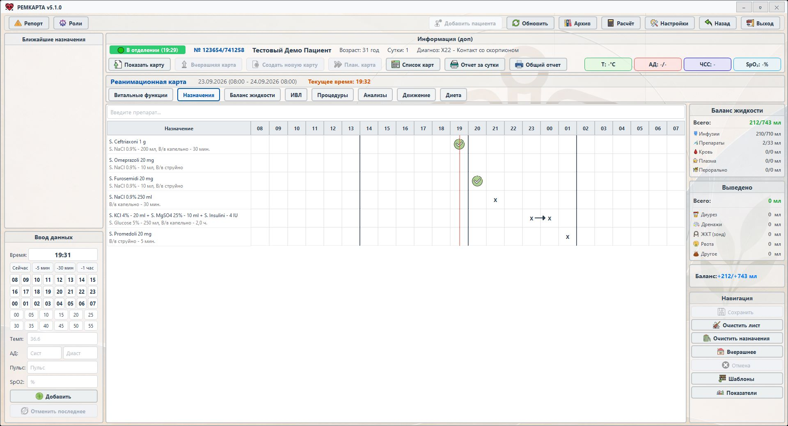
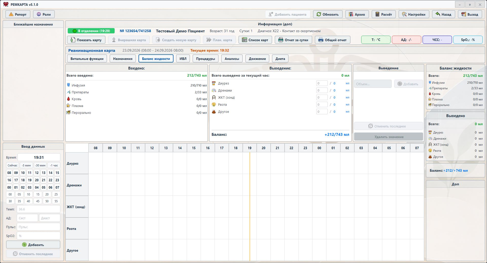
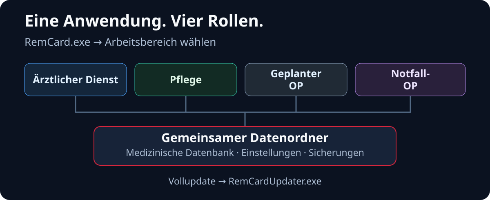

<p align="center">
  <a href="README.md"><kbd>English</kbd></a>
  <a href="README.ru.md"><kbd>Русский</kbd></a>
  <a href="README.zh-CN.md"><kbd>中文（简体）</kbd></a>
  <a href="README.ja.md"><kbd>日本語</kbd></a>
  <a href="README.de.md"><kbd><strong>Deutsch</strong> ✓</kbd></a>
</p>

<p align="center">
  
</p>

<h1 align="center">RemCard ICU — elektronische Intensivdokumentation</h1>

<p align="center">
  <strong>RemCard ist eine Windows-Anwendung zur Patientendokumentation und gemeinsamen Schichtarbeit auf der Intensivstation und im OP.</strong><br>
  Anordnungen, Vitalparameter, Flüssigkeitsbilanz, Beatmung, Eingriffe, Laborwerte, Ereignisse, Berichte und Archiv in einem gemeinsamen Arbeitsablauf.
</p>

<p align="center">
  <code>Version 5.1.10</code> · <code>Windows</code> · <code>Python 3.11</code> · <code>PySide6</code> · <code>SQLite</code> · <code>RemCard Proprietary Source License</code> · <code>Experimentelles Projekt</code>
</p>

<p align="center">
  <a href="https://cliniciansthatcode.com/directory/#p-vadim-bityutsky"></a><br>
  <sub>Der Autor von RemCard ist im Verzeichnis Clinicians That Code aufgeführt. Der Eintrag ist kein Nachweis einer klinischen Validierung der Software.</sub>
</p>

<p align="center">
  <a href="#die-anwendung-im-einsatz">Oberfläche</a> ·
  <a href="#funktionen-der-aktuellen-version">Funktionen</a> ·
  <a href="#so-funktioniert-das-gemeinsame-system">Architektur</a> ·
  <a href="#schnellstart-aus-dem-quellcode">Start aus dem Quellcode</a> ·
  <a href="#installierte-version-und-updates">Installation und Updates</a> ·
  <a href="docs/README.md">Dokumentation</a> ·
  <a href="CHANGELOG.md">Änderungen</a> ·
  <a href="LICENSE">Lizenz</a>
</p>

Übersicht zu **RemCard 5.1.10**, aktualisiert am **22. Oktober 2026**. RemCard wurde vom Anästhesisten und Intensivmediziner Vadim Bityutsky entwickelt. Die gemeinsame Anwendung `RemCard.exe` bietet die Auswahl zwischen vier Rollen; das separate Programm `RemCardUpdater.exe` installiert vollständige Updates. Die Quellcodeversion steht in [`VERSION`](VERSION), die Zusammensetzung einer konkreten Ausgabe in deren Manifest.

**Die Übersetzungen betreffen ausschließlich die README-Dateien.** Die Anwendungsoberfläche, die Screenshots und der überwiegende Teil der verlinkten ausführlichen Dokumentation sind weiterhin auf Russisch.

In [Version 5.1.10](https://github.com/Donkiton/rem_card/releases/tag/v5.1.10) können kleine Änderungen auch bei einer umfangreichen Historie als Delta an die lokale Replik übertragen werden. Das Abrufen des Patientenstatus über das Netzwerk wurde aus dem Oberflächenthread des Pflegearbeitsplatzes ausgelagert; verspätete Antworten dürfen neuere Daten nicht mehr ersetzen. Sichere Wiederholungsversuche beim Speichern des Anfangsstatus und das Laden der nächtlichen Sicherung nach Freigabe der Sperre der gemeinsamen Datenbank wurden präzisiert. Prüfungen der Zusammenarbeit zwischen ärztlichem und pflegerischem Arbeitsplatz sind im [Prüfbericht zur Synchronisierung](docs/sync_responsiveness_validation.md) beschrieben; die Regeln für die Replik und die Grenzen der Messungen im [Replik-Vertrag](docs/source_of_truth_and_sync_contract.md) und in der [Messmethodik](docs/replica_delta_benchmark.md).

Das fertige Paket 5.1.10 wurde so erstellt, dass Migrationen der gemeinsamen Datenbank und eine Anhebung der minimal zulässigen Clientversion gesperrt sind. Für kompatible Arbeitsplätze ist dies ein **optionales Update**: Es muss nicht auf allen Rechnern gleichzeitig installiert werden. Der erste vollständige Snapshot hängt weiterhin von der Netzwerkgeschwindigkeit und der Datenbankgröße ab.

> [!WARNING]
> **RemCard ist kein Medizinprodukt und ersetzt weder klinische Protokolle noch klinische Entscheidungen oder die verantwortliche Kontrolle durch medizinisches Fachpersonal.** Für den tatsächlichen Einsatz sind eine unabhängige technische, sicherheitstechnische und klinische Prüfung, die Abnahme in der vorgesehenen Umgebung sowie ein Ersatzarbeitsablauf erforderlich.

## Die Anwendung im Einsatz

Screenshots von **RemCard 5.1.0** mit Demonstrationspatienten; die aktuelle Version ist **5.1.10**. Ein Klick auf ein Bild öffnet es in voller Größe.

### Gemeinsamer Einstieg und Rollenauswahl

[](docs/assets/readme/remcard-roles-5-1.jpg)

Eine Anwendung für vier Arbeitsplätze. Die Schaltfläche **„Rollen“ («Роли»)** führt zurück zur Rollenauswahl; auf dem Anmeldebildschirm stehen ein helles und ein dunkles Design zur Verfügung.

### Patientenliste

[](docs/assets/readme/remcard-patients-5-1.jpg)

Aktuelle Patienten nach Betten, die letzten Messwerte und direkter Zugriff auf Patientenkurve und Berichte.

<details>
<summary><strong>Bettenverwaltung und Patientenaufnahme</strong></summary>

### Patientenverwaltung

[](docs/assets/readme/remcard-beds-5-1.jpg)

Die Schaltfläche **„Patient hinzufügen“ («Добавить пациента»)** öffnet die Bettenverwaltung. Wählen Sie ein freies Bett und klicken Sie auf „BETT BELEGEN“ («ЗАНЯТЬ КОЙКУ»), um die Aufnahme zu erfassen. Bei einem belegten Bett können die Patientendaten geöffnet werden.

</details>

### Anordnungsblatt

[](docs/assets/readme/remcard-orders-5-1.jpg)

Medikamente, Applikationswege, Zeitplan und Durchführungsnachweise auf der Schichtachse von 08:00 Uhr bis 08:00 Uhr des Folgetags.

### Flüssigkeitsbilanz

[](docs/assets/readme/remcard-balance-5-1.jpg)

Infusionen, Medikamente, Blut, Plasma und orale Zufuhr werden der Ausfuhr gegenübergestellt; eine Stundentabelle und die Gesamtbilanz sind daneben verfügbar.

<!-- Ein neuer Screenshot der Vitalparameterkurven aus Version 5.1.0 wird dieser Galerie gesondert hinzugefügt. -->

## Rollen in einem gemeinsamen Arbeitsablauf

- **Ärztlicher Arbeitsplatz** — Aufnahmen und Betten, Patientenkurve nach Schichten, Anordnungen und Vorlagen, Ernährungsplanung, Eingriffe, Behandlungsausgänge, Archiv, Berichte und Rechner.
- **Pflegearbeitsplatz** — anstehende Anordnungen, Durchführungsnachweise, tatsächlich aufgenommene Nahrung, Verlauf während der Schicht, Druck und Arbeitsstatistik.
- **OP** — Notfall- und elektiver OP, Schnellanordnungen, Medikamente, Operationsphasen und Ereignisse, Verlegung zwischen Intensivstation (РАО) und OP, Fallabschluss und Berichte.
- **Administration** — zentrale Einstellungen, Zustand der aktuellen und archivierten Datenbanken, Sicherungen, Stammdaten, Druck, Darstellung und Diagnose.

## Funktionen der aktuellen Version

### Gemeinsame Anwendung 5.1

Ärztlicher Arbeitsplatz, Pflegearbeitsplatz, elektiver und Notfall-OP werden aus einem gemeinsamen Fenster geöffnet. Beim Rollenwechsel schließt die Anwendung die bereits angenommenen Schreibvorgänge ab und gibt die Ressourcen der vorherigen Sitzung frei. Die Datenbankprüfung und die Vorbereitung des Arbeitsplatzes zeigen ihren jeweiligen Status an; der Einstieg kann abgebrochen werden. Die Startdiagnose hilft, Verzögerungen beim Öffnen der Anwendung und der jeweiligen Rolle zu untersuchen.

Die Auswahl des Datenordners ist in die Anwendung integriert. Ein gemeinsamer Wartungsmodus koordiniert den Datenbankzugriff der Arbeitsplätze. Ist die zentrale Datenbank nicht erreichbar, prüft der Notfallzugang, ob eine lokale Kopie vorhanden, verwendbar und ausreichend aktuell ist. Die Rückkehr zum Netzwerkbetrieb und die Übertragung der Änderungen erfolgen in einem gesonderten Ablauf.

### Patientenkurve und Schichtarbeit

Die Patientenkurve umfasst Anordnungen und deren Durchführung, Vitalparameter und Diagramme, Flüssigkeitseinfuhr und -ausfuhr, Beatmung, Eingriffe, Laboruntersuchungen und klinische Ereignisse. Der Zugriff auf die aktuelle Kurve, die Kurve des Vortags und die vorausgeplante Kurve ist getrennt; die Patientenhistorie ist über das Archiv zugänglich. Für Anordnungen stehen Stammdaten für Medikamente, Lösungsmittel und Applikationswege sowie Vorlagen und ein Schichtzeitplan zur Verfügung.

Auf der Registerkarte **„Ernährung“ («Диета»)** legt das ärztliche Personal den Ernährungsplan fest und wendet bearbeitbare Vorlagen an; die Pflege dokumentiert die tatsächliche Aufnahme. Eine verweigerte Zufuhr lässt sich als **0 ml** speichern. Dokumentierte Ernährungsmengen fließen in die Flüssigkeitsbilanz ein; eigene Änderungen können schrittweise rückgängig gemacht werden. Eine Prüfung der Datensatzversion verhindert, dass Änderungen anderer Benutzer überschrieben werden.

Dokumente für Eingriffe, darunter zentralvenöse Katheter, Lumbalpunktionen und Bluttransfusionen, sowie PDF-Berichte zur Patientenkurve und zum OP-Fall stehen zur Verfügung.

### Rechner und Überwachung der Flüssigkeitstherapie bei Verbrennungen

Das Menü **„Berechnung“ («Расчёт»)** in Sektor 8 vereint Rechner für Infusionen, Elektrolyte und Verbrennungen. Der Verbrennungsrechner ist für ärztliches und pflegerisches Personal aus der Patientenkurve zugänglich, wenn eine entsprechende ICD-Diagnose vorliegt.

Er berücksichtigt Alter, Gewicht, verbrannte Körperoberfläche und Verletzungszeitpunkt und unterstützt den ersten, zweiten und dritten Tag sowie die Zeit nach Überwindung des Schocks. Tatsächliche Flüssigkeitszufuhr und Urinausscheidung werden aus den gespeicherten Kurvendaten geladen; bei den pädiatrischen Schemata für den ersten sowie den zweiten und dritten Tag wird auch die tatsächliche enterale Zufuhr berücksichtigt. Das Fenster zeigt Berechnungszeitraum, Überwachungszeitpunkt, Restvolumen und Abweichung vom berechneten Zeitplan. Der Tag der Patientenkurve und der seit der Verletzung vergangene Tag werden getrennt erfasst.

Die Daten werden beim Öffnen des Rechners geladen. Der Befehl **„Aus Kurve aktualisieren“ («Обновить из карты»)** liest sie erneut ein und behält dabei die als manuell markierten Werte bei. Ein Lesefehler wird nicht als Nullvolumen behandelt; eine Änderung der Eingabedaten verwirft das vorherige Ergebnis. Die Berechnung lässt sich mit Erläuterungen kopieren; Anordnungen werden nicht automatisch angelegt. Ausführliche Regeln und Einschränkungen enthält die [Dokumentation des Rechners](docs/burn_infusion_calculator.md).

### Gemeinsames Archiv und Analysen

Die Archivzentrale steht ärztlichem Personal, Pflege und Administration entsprechend ihren Rollen zur Verfügung. Sie vereint das Patientenarchiv der Intensivstation, das Archiv der OP-Fälle, Analysen, Diagramme und statistische Berichte. Zum Anzeigen einer Kurve aus einer Archivdatenbank wird ein eigener Lesedienst verwendet.

Für Analysen können Zeitraum und Patientengruppe gewählt, Filter angewendet, Ansichten gespeichert sowie Zeiträume oder Gruppen verglichen werden. Zu jeder Kennzahl sind das Ergebnis, die Berechnungsmethode und die Liste der eingeschlossenen Fälle verfügbar. Ein gemeinsames Kennzahlenregister legt Einheiten, Quellen und Einschlusskriterien fest; die Datenqualitätsprüfung erkennt Duplikate und widersprüchliche Werte. Fehlende Vergleichsdaten werden ausdrücklich gekennzeichnet. Berechnungen und Diagrammerstellung laufen im Hintergrund; Berichte und Diagramme verwenden einen konsistenten Analysesnapshot.

Definitionen der Kennzahlen und Grenzen der technischen Prüfung sind im [Analysevertrag](docs/analytics_clinical_contract.md) und in der [Implementierungsmatrix](docs/analytics_implementation_matrix.md) beschrieben.

### OP, Einstellungen und Diagnose

Die Arbeitsplätze für Notfall- und elektive Operationen dokumentieren den OP-Fall: Team, Anästhesieverfahren, Phasen, Messwerte, Medikamente und Schnellanordnungen. Die Übergabe von der Intensivstation ist mit der Patientenverlegung und der Aufnahme im OP verknüpft. Bei Netzwerkproblemen steht ein gesonderter, eingeschränkter lokaler OP-Modus zur Verfügung; seine Daten werden nach Wiederherstellung der Verbindung in einem speziellen Verfahren übertragen.

Die Einstellungszentrale vereint Stammdaten, OP-Parameter, Ernährungsvorlagen, Laborkatalog, Druck, Designs, Hintergründe und Datenbankwartung. Benutzeranfragen können Diagnoseprotokolle enthalten. Für technische Protokolle gelten Rotation, Aufbewahrungsfristen und ein Größenbudget; häufige reguläre Messwerte werden zu Minutenzusammenfassungen verdichtet, wiederholte Fehler zu kompakten Einträgen mit Kontext. Das medizinische Änderungsprotokoll wird getrennt von technischen Protokollen und Synchronisierungsmeldungen gespeichert.

## So funktioniert das gemeinsame System

<p align="center">
  <a href="https://donkiton.github.io/rem_card/codemap/codemap.html"></a>
</p>

RemCard ist eine **PySide6**-Desktopanwendung mit einem gemeinsamen Datenordner. Die gemeinsame SQLite-Datenbank liegt im lokalen Netzwerk der Organisation. Für den regulären Betrieb der Arbeitsplätze wird kein separater Webserver benötigt. Der Hauptpfad lautet **Oberfläche → Dienste → DAO → SQLite**.

1. **Speichern.** Die Oberfläche übergibt eine Änderung an die Schreibwarteschlange. Der Controller erwirbt eine Dateisperre und führt eine Transaktion aus; erfolgreiches Speichern wird erst nach `COMMIT` in der zentralen Datenbank bestätigt. Ein Entwurf oder ein Eintrag in der Warteschlange bedeutet für sich genommen noch nicht, dass die Daten gespeichert sind.
2. **Aktualisierung anderer Arbeitsplätze.** Trigger schreiben in derselben Transaktion Benachrichtigungen in `change_log`. `DataUpdateMonitor` erkennt Änderungen, `SyncCoordinator` verwirft veraltete Daten, und der Arbeitsplatz liest den benötigten Snapshot erneut ein. Cache-Dateien werden nicht zwischen Rechnern übertragen.
3. **Schneller Lesezugriff.** `ReadCoordinator`, Snapshots und ein lokaler Cache beschleunigen die Anzeige. Die erste lokale Replik entsteht über die SQLite Backup API; danach werden kleine Änderungen auf eine separate lokale Kandidatenkopie angewendet. Diese wird geprüft und ersetzt die bisherige Kopie atomar; bei Überschreitung von Grenzwerten oder Inkompatibilität erfolgt eine vollständige Kopie. Die Replik dient ausschließlich dem Lesen. Liegt ihre Version hinter dem erforderlichen Stand zurück, wird aus der zentralen Datenbank gelesen. Maßgeblich für klinische Daten bleibt der zentrale Datensatz nach `COMMIT`.
4. **Reaktionsfähigkeit.** Das Laden von Snapshots, Schreibvorgänge über das Netzwerk, Analysen und PDF-Erstellung nutzen Hintergrundaufgaben. Verspätete Ergebnisse werden geprüft, bevor sie auf den geöffneten Patienten oder den ausgewählten Zeitraum angewendet werden.

### Wo sich die Implementierung befindet

| Verzeichnis | Zuständigkeit |
| --- | --- |
| [`ui/`](ui/) | Ärztliche und pflegerische Arbeitsplätze, OP, Bereiche der Patientenkurve, Archiv, Eingriffe und Oberflächeneinstellungen. |
| [`services/`](services/) | Anwendungsoperationen, Berechnungen, Bilanz, Ernährung sowie Koordination von Lesezugriffen und Synchronisierung. |
| [`services/analytics/`](services/analytics/) | Kennzahlenregister, Abfragen, Kohorten, Vergleiche, Statistiken und Diagrammdaten. |
| [`data/`](data/) | DAO, Modelle, Stammdaten und separate Einstellungsdatenbank. |
| [`app/`](app/) | Start und Rollen, Pfade, SQLite-Infrastruktur, Replik, Sicherungen, Notfallmodi, Protokolle und Updates. |
| [`scripts/`](scripts/), [`tests/`](tests/) | Build und Veröffentlichung, CI, Qualitätsprüfungen, automatisierte Tests und Sicherheitsszenarien. |

Der ausführliche [Vertrag zur maßgeblichen Datenquelle und Synchronisierung](docs/source_of_truth_and_sync_contract.md) beschreibt Transaktionsgrenzen, Aktualität der Replik und Cache-Regeln.

## Interaktive Architekturkarte

<p align="center">
  <a href="https://donkiton.github.io/rem_card/codemap/codemap.html"><strong>Interaktive RemCard-Karte öffnen →</strong></a><br>
  <sub>24 Hauptmodule · 48 belegte Verbindungen · 6 durchgängige Abläufe</sub>
</p>

Die Karte wurde am **23. September 2026** für die Architektur der gemeinsamen Anwendung aktualisiert: Start über `run_remcard.py`, Rollenauswahl, Datenbankzulassung, Hintergrundprüfung, Sitzungsende, Lesereplik und vollständiges Update. Sie zeigt die Hauptkomponenten und ist kein Verzeichnis sämtlicher Dateien; der zugrunde liegende Commit ist auf der Karte angegeben. Ein Klick auf ein Modul zeigt eingehende und ausgehende Verbindungen, zugehörige Tests, Quellpfade und die als Belege dienenden Symbole. Außerdem lassen sich durchgängige Abläufe auswählen, Komponenten suchen, Modultypen filtern sowie die Darstellung vergrößern, verkleinern und verschieben.

Die Karte läuft vollständig im Browser und sendet keine Daten an einen externen Server. Die überprüfbaren Ausgangsdaten stehen in [`codemap.json`](docs/codemap/codemap.json), die eigenständige HTML-Version in [`codemap.html`](docs/codemap/codemap.html).

## Schnellstart aus dem Quellcode

Das Projekt wird unter **Windows mit Python 3.11** entwickelt und getestet. Git und Python werden benötigt; eine `.env`-Datei ist nicht erforderlich.

```powershell
git clone https://github.com/Donkiton/rem_card.git
cd rem_card
py -3.11 -m venv .venv
.\.venv\Scripts\Activate.ps1
python -m pip install --upgrade pip
python -m pip install -r requirements.txt
python run_remcard.py
```

`run_remcard.py` öffnet die gemeinsame Anwendung mit Rollenauswahl.

> [!CAUTION]
> Verwenden Sie für Entwicklung und Tests einen separaten Datenordner statt der produktiven Datenbank. Sperren und Zugriffsprüfungen ersetzen keine isolierte Testumgebung. Die gemeinsame Anwendung verwendet die Sitzungszulassung `SessionLease`.

<details>
<summary><strong>Entwicklungsdatenbank: Auswahl und Schutz vor unbeabsichtigtem Ersatz</strong></summary>

Die aus dem Quellcode gestartete Version verwendet einen lokalen Datenordner für die Entwicklung; beim ersten Start kann die fehlende Verzeichnisstruktur angelegt werden. Die Liste ausgewählter Ordner und der aktive Pfad werden für jeden Checkout separat in `.remcard/dev_database_paths.json` gespeichert.

Eine ausgewählte vorhandene Datenbank wird mit einer Prüfung geöffnet: Die Anwendung darf nicht unbemerkt eine leere Datenbank anstelle einer verschwundenen anlegen. Der alte Pfad `%LOCALAPPDATA%\RemCard\dev_database_paths.json` wird nur zur einmaligen Übernahme der Einstellung verwendet.

</details>

## Installierte Version und Updates

Die Windows-Version für den Betrieb wird als vollständiger PyInstaller-Ordner verteilt, nicht als MSI oder Docker-Image.

| Datei | Zweck |
| --- | --- |
| `RemCard.exe` | Gemeinsame Anwendung: Rollenauswahl, Arbeitsplätze und Auswahl des Datenordners. |
| `RemCardUpdater.exe` | Hilfsprogramm zur Installation eines vollständigen Updates. |

Starten Sie **`RemCard.exe`**, wählen Sie beim ersten Start den Datenordner und anschließend die gewünschte Rolle. Bewahren Sie den vollständigen Programmordner einschließlich `_internal` auf: Die EXE allein reicht nicht aus. Neben der Anwendung wird `remcard_data_path.json` gespeichert; Updates werden in `<папка данных>\UPD\releases` gesucht, wobei `<папка данных>` für den gewählten Datenordner steht.

Die separaten Programme `RemCardDoctor.exe`, `RemCardNurse.exe`, die OP-EXE-Dateien und `RemCardPathSetup.exe` gehören zum früheren Auslieferungsmodell. Version 5.1 verwendet einen gemeinsamen Einstieg. Das Projekt verteilt ausschließlich **vollständige Updates**: `PATCH` in SemVer bezeichnet die Versionsstufe und kein separates Paketformat.

<details>
<summary><strong>Test-Build und sichere Veröffentlichung für den Produktivbetrieb</strong></summary>

Ein Build des aktuellen Arbeitsverzeichnisses ohne Veröffentlichung:

```powershell
.\.venv\Scripts\python.exe scripts\build_release.py --test-worktree
```

Dieser führt die vorgeschriebenen Prüfungen, PyInstaller und einen Smoke-Test beider EXE-Dateien aus. Dabei werden `VERSION`, `CHANGELOG.md` und `app/release_info.json` nicht geändert, kein Commit erstellt, kein `git push` ausgeführt und kein Paket veröffentlicht. Das Ergebnis erhält die Kennzeichnung `TEST_WORKTREE_ONLY.txt` und kann deshalb nicht versehentlich für den Produktivbetrieb veröffentlicht werden.

Für eine reguläre Veröffentlichung müssen Version und exakter Commit zunächst in GitHub `main` vorliegen; anschließend startet die für die Veröffentlichung verantwortliche Person `scripts\build_release.py` mit `--expected-version` und `--expected-commit`. Nach der Abnahme mit einer isolierten Testdatenbank wird das Paket mit dem separaten Befehl `scripts\publish_full_update.py` übertragen. `ready.ok` wird zuletzt angelegt: Sobald diese Datei vorhanden ist, steht die Version den Clients dieser Datenbank sofort zur Verfügung. Einzelheiten: [Build und Veröffentlichung](docs/how_to_build_and_update.md) und [automatische Updates](docs/auto_update.md).

</details>

## Gemeinsame SQLite-Datenbank und Datensicherheit

Die medizinische Datenbank befindet sich unter `archiv/rao_journal.db`, Stammdaten und gemeinsame Einstellungen einschließlich Designs und Hintergründen unter `settings/remcard_settings.db`. Benutzerdefinierte Hintergrundbilder liegen in `settings/backgrounds`. Alle Pfade sind relativ zum ausgewählten Datenordner angegeben. Die JSON-Stammdatendateien im Repository dienen als Ausgangsdaten und Kompatibilitätsschicht, sind aber nicht die maßgebliche Datenquelle der installierten Version. Einzelheiten enthält die [Beschreibung der Einstellungsdatenbank](docs/settings_db.md).

Für die gemeinsame Datenbank im Netzwerk gelten folgende Regeln:

- `journal_mode=DELETE`, `synchronous=EXTRA`, `mmap_size=0`; WAL ist für die gemeinsame Datenbank verboten.
- Schreibvorgänge erfolgen über Controller, Dateisperre und Transaktionen.
- Eine laufende Datenbank wird ausschließlich über die SQLite Backup API gesichert, nicht durch einfaches Kopieren der geöffneten Datei.
- Für Migrationen, Wiederherstellung und Rotation sind überprüfte Sicherungen sowie `quick_check` und `integrity_check` vorgesehen.

Diese Maßnahmen verringern bekannte Risiken, machen aber nicht jede beliebige Ablage von SQLite im Netzwerk automatisch sicher. Zugriffsrechte, Latenzen, Sicherung und Wiederherstellung erfordern eine gesonderte betriebliche Abnahme. Siehe [Datenbanksicherheit](docs/db_safety_contract.md) und [Vertrag zur maßgeblichen Datenquelle und Synchronisierung](docs/source_of_truth_and_sync_contract.md).

## Prüfungen für die Entwicklung

Lokale Prüfungen und GitHub Actions verwenden denselben Einstiegspunkt. Nach der Installation der Abhängigkeiten in der aktivierten Umgebung:

```powershell
python scripts\run_ci_checks.py core
python scripts\run_ci_checks.py ui
python scripts\run_ci_checks.py quality
python scripts\run_ci_checks.py regression
git diff --check
```

`core` prüft Logik und Daten, `ui` die Qt-Oberfläche, `quality` die Codequalität und Architekturvorgaben und `regression` das vollständige Register der Sicherheitsszenarien. In CI laufen die Gruppen unabhängig; der abschließende Status `tests` prüft ihren Erfolg und die Vollständigkeit der Berichte. Die pytest-Module sind in [`tests/groups.json`](tests/groups.json) ohne Auslassungen oder Dopplungen aufgeteilt.

Der Befehl `python scripts\run_ci_checks.py all` führt alle pytest-Tests in einem Prozess aus, um ihre gemeinsame Isolation zu prüfen; er ersetzt die separaten Gruppen `quality` und `regression` nicht. Der Runner weist temporäre Pfade für Datenbanken und QSettings zu und speichert Berichte unter `tmp/ci-reports/<группа>`, wobei `<группа>` die Prüfgruppe bezeichnet. Für gezielte Prüfungen ist auch der gewöhnliche Aufruf `python -m pytest tests -q` verfügbar. Weitere Informationen: [Tests und CI](docs/testing.md).

Netzwerktestumgebungen, Wiederherstellungsübungen sowie Notfall- und Offline-Modi lesen oder ändern den ausgewählten Datenordner. Führen Sie diese nur mit einer bewusst ausgewählten Testdatenbank gemäß der [Abnahmeregelung](docs/operational_acceptance.md) und der [Anleitung zur Prüfung von Sicherungen](docs/backup_restore_drill.md) aus.

## Dokumentation, Status und Kontakt

- [Dokumentationsübersicht](docs/README.md) — geltende Verfahren und historische Unterlagen.
- [Projektwebsite](https://donkiton.github.io/rem_site/#english) und [Veröffentlichungen](https://github.com/Donkiton/rem_card/releases) — Projektvorstellung und veröffentlichte Versionen.
- [Interaktive Architekturkarte](https://donkiton.github.io/rem_card/codemap/codemap.html) — Module, Abhängigkeiten, Tests und durchgängige Abläufe mit Verweisen auf den Quellcode.
- [Änderungsverlauf](CHANGELOG.md) und [`VERSION`](VERSION) — Änderungen und aktuelle Version.
- [Tests und CI](docs/testing.md) — Testgruppen, Isolation, Vollständigkeitskontrolle und Berichte.
- [Verbrennungsrechner](docs/burn_infusion_calculator.md) und [Analysevertrag](docs/analytics_clinical_contract.md) — Berechnungen, Datenquellen und Einschränkungen.
- [Versionierung](docs/versioning.md), [automatische Updates](docs/auto_update.md) und [Build](docs/how_to_build_and_update.md) — Verfahren für vollständige Veröffentlichungen.
- [Vertrag zur Datenbanksicherheit](docs/db_safety_contract.md), [maßgebliche Datenquelle und Synchronisierung](docs/source_of_truth_and_sync_contract.md), [betriebliche Abnahme](docs/operational_acceptance.md) und [Notfallanleitung](docs/emergency_runbook.md) — sicherer Betrieb.

Das Projekt ist experimentell und wird aktiv weiterentwickelt. Tests, statische Prüfungen, Sicherungen und Schutzmechanismen ersetzen keine unabhängige technische, informationssicherheitstechnische und klinische Prüfung.

Für Fehlermeldungen und Vorschläge zu Architektur, Leistung und sicherem Betrieb: [menfise@mail.ru](mailto:menfise@mail.ru), Betreff: `РЕМ КАРТА`.

## Lizenz und Verantwortung

Urheber des Konzepts, der Architektur und des ursprünglichen Quellcodes sowie Entwickler von RemCard ist Vadim Aleksejewitsch Bityutsky (Битюцкий Вадим Алексеевич; GitHub: [DonKiton](https://github.com/DonKiton)).

RemCard wird unter der [RemCard Proprietary Source License 1.1](LICENSE) bereitgestellt, die natürlichen Personen eine nichtkommerzielle Nutzung gestattet. Einzelne Benutzer oder Entwickler dürfen den Code kostenlos ansehen, herunterladen, kopieren, ausführen, untersuchen und ändern sowie die ursprüngliche oder eine veränderte Version weitergeben, sofern sie dafür weder Geld noch einen anderen kommerziellen Vorteil erhalten. Bei der Weitergabe müssen die Lizenz und die Urheberangaben erhalten bleiben, vorgenommene Änderungen angegeben, der Quellcode bereitgestellt und der inoffizielle Status einer Modifikation klar kenntlich gemacht werden.

Jede Nutzung durch eine Organisation oder im Interesse eines Arbeitgebers, Kunden, Unternehmens, einer Klinik oder Einrichtung erfordert die vorherige schriftliche Erlaubnis des Rechteinhabers. Ohne gesonderte Vereinbarung sind Verkauf und Weiterverkauf, entgeltliche Einführung, Installation, Integration, Weiterentwicklung, Betreuung, Schulung, Beratung, Hosting, SaaS, Abonnements, Werbung und jede andere Monetarisierung verboten. Diese Einschränkungen gelten für alle abgeleiteten Versionen: Eine Änderung von Schriftart, Oberfläche, Funktionen, Namen oder anderen Programmteilen verleiht kein Recht, damit Geld zu verdienen.

Die öffentliche Bereitstellung und ein Fork innerhalb von GitHub gewähren keine kommerziellen Rechte. Das Programm wird „wie besehen“ bereitgestellt; die Nutzung erfolgt in eigener Verantwortung. Bibliotheken und Abhängigkeiten Dritter behalten ihre eigenen Lizenzen. Nach der OSI-Einteilung handelt es sich um eine Source-available-Lizenz und nicht um eine Open-Source-Lizenz, da die kommerzielle Nutzung eingeschränkt ist. Bei Abweichungen zwischen dieser Zusammenfassung und dem vollständigen Lizenztext hat die Datei [LICENSE](LICENSE) Vorrang.
