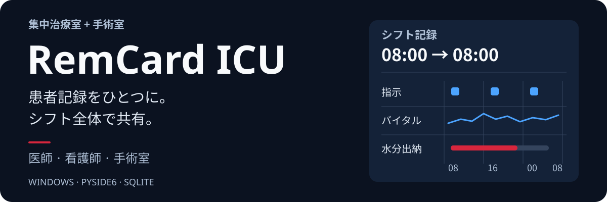

  <a href="README.md"><kbd>Русский</kbd></a>
  <a href="README.en.md"><kbd>English</kbd></a>
  <a href="README.zh-CN.md"><kbd>中文（简体）</kbd></a>
  <a href="README.ja.md"><kbd><strong>日本語</strong> ✓</kbd></a>
  <a href="README.de.md"><kbd>Deutsch</kbd></a>

  

  <strong>ICUと手術室の患者記録と、勤務帯を通じたチームの連携を支えます。</strong> 
  医師、看護師、予定手術・緊急手術のチームが使う、ひとつのWindowsアプリケーション。

  <a href="VERSION">v5.1.10</a> · Windows · Python 3.11 · PySide6 · SQLite 
  <a href="https://github.com/Donkiton/rem_card/releases">リリース</a> ·
  <a href="#詳しく読む">ドキュメント</a> ·
  <a href="https://donkiton.github.io/rem_site/#english">Webサイト</a> ·
  <a href="LICENSE">ライセンス</a>

> [!WARNING]
> **実験的なソフトウェアであり、医療機器ではありません。** 臨床での使用には、独立した技術・臨床検証、使用環境での受け入れ試験、および代替の業務手順が必要です。

## 利用画面を見る

デモ患者を使用した**5.1.0**のスクリーンショットです。画面はロシア語です。各項目を開くと画像を表示できます。

<strong>業務画面と役割の選択</strong>

共通の入口から4つの業務画面へ。ライトテーマとダークテーマに対応しています。

<strong>患者、病床、入院登録</strong>

病床の状況確認、入院登録、患者記録へのすばやい移動。

<strong>薬剤指示と水分出納</strong>

08:00から翌日08:00までの勤務帯に沿って、指示、実施記録、水分出納を確認できます。

## 主な機能

- **患者記録** — 指示と実施状況、バイタルサイン、水分出納、人工呼吸、栄養、処置、検査結果。
- **チームの連携** — 医師・看護師の業務画面、予定・緊急手術室、ICUと手術室の間の患者引き継ぎ。
- **臨床支援ツール** — 輸液・電解質・熱傷の計算ツールとPDFレポート。
- **アーカイブと分析** — 患者・手術症例の履歴、絞り込み、比較、グラフ。

## はじめに

配布版を使用する場合は、`_internal` を含む配布フォルダー一式から **`RemCard.exe`** を起動してください。

ソースからの起動、データフォルダーの選択、更新については、[セットアップガイド](docs/guide/setup.ja.md)を参照してください。開発と試験には、独立したテスト用データベースが必要です。

## 詳しく読む

| ガイド | 内容 |
| --- | --- |
| [機能](docs/guide/features.ja.md) | 業務画面、患者記録、栄養、計算ツール、分析。 |
| [セットアップと保守](docs/guide/setup.ja.md) | ソースからの起動、インストール、更新、データの安全性、開発者向けチェック。 |
| [アーキテクチャ](docs/guide/architecture.ja.md) | 共有データ、同期、インタラクティブなコードマップ。 |

詳細な技術手順は、[ドキュメント一覧](docs/README.md)に掲載されています。主にロシア語で記述されています。

   
  麻酔科・集中治療医Vadim Bityutskyが開発 · <a href="mailto:menfise@mail.ru">お問い合わせ</a>

