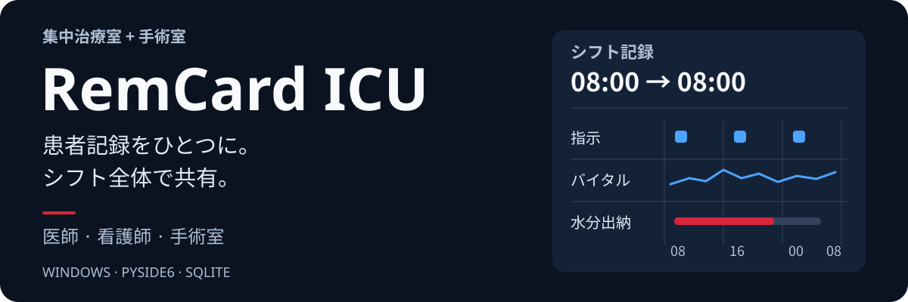
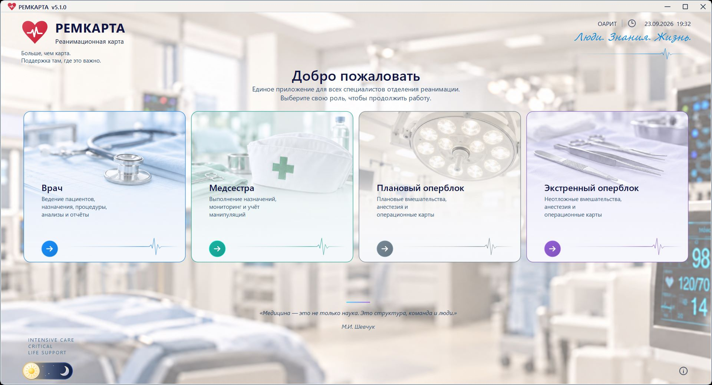
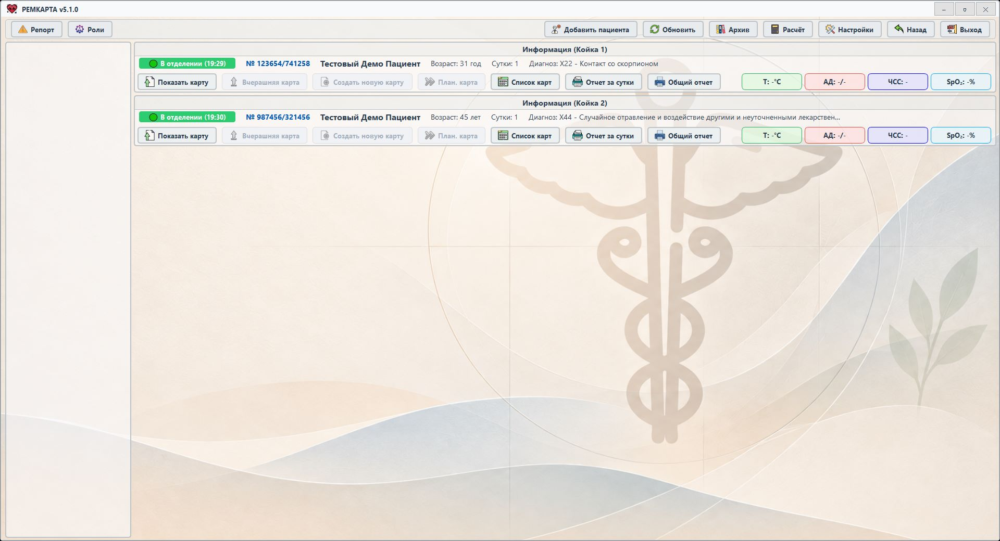
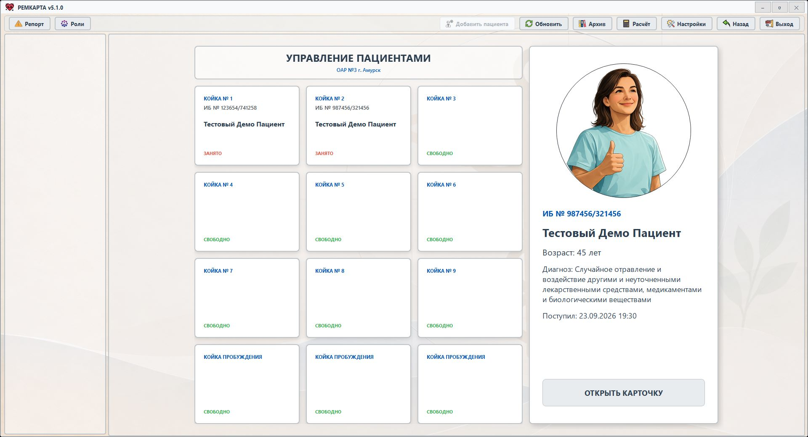
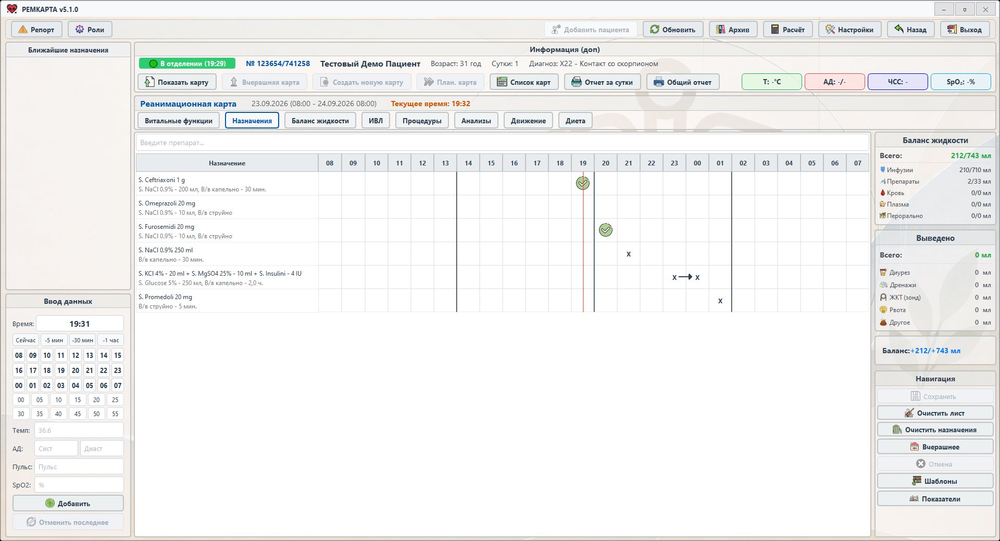
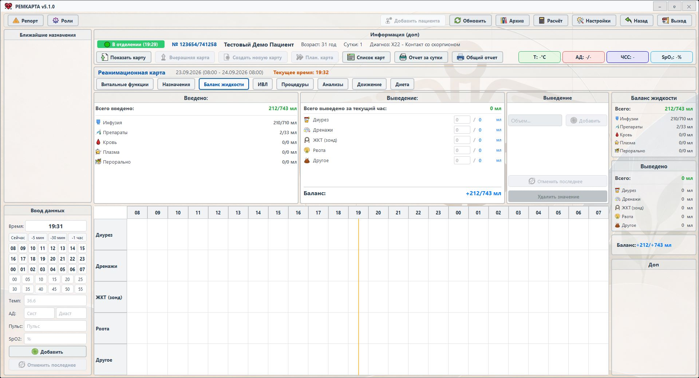
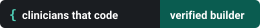

  <a href="README.md"><kbd>Русский</kbd></a>
  <a href="README.en.md"><kbd>English</kbd></a>
  <a href="README.zh-CN.md"><kbd>中文（简体）</kbd></a>
  <a href="README.ja.md"><kbd><strong>日本語</strong> ✓</kbd></a>
  <a href="README.de.md"><kbd>Deutsch</kbd></a>

  

  <strong>ICUと手術室の患者記録と、勤務帯を通じたチームの連携を支えます。</strong> 
  医師、看護師、予定手術・緊急手術のチームが使う、ひとつのWindowsアプリケーション。

  <a href="VERSION">v5.1.20</a> · Windows · Python 3.11 · PySide6 · SQLite 
  <a href="https://github.com/Donkiton/rem_card/releases">リリース</a> ·
  <a href="#詳しく読む">ドキュメント</a> ·
  <a href="https://donkiton.github.io/rem_site/ja/">Webサイト</a> ·
  <a href="LICENSE">ライセンス</a>

> [!WARNING]
> **実験的なソフトウェアであり、医療機器ではありません。** 臨床での使用には、独立した技術・臨床検証、使用環境での受け入れ試験、および代替の業務手順が必要です。

## 利用画面を見る

[PC向けブラウザーデモを開く](https://donkiton.github.io/rem_site/ja/demo/) — 架空の患者を使ったデスクトップ版のデモです。スマートフォン向けには調整されていないため、パソコンで開いてください。

デモ患者を使用した**5.1.0**のスクリーンショットです。画面はロシア語です。各項目を開くと画像を表示できます。

<strong>業務画面と役割の選択</strong>

共通の入口から4つの業務画面へ。ライトテーマとダークテーマに対応しています。

<strong>患者、病床、入院登録</strong>

病床の状況確認、入院登録、患者記録へのすばやい移動。

<strong>薬剤指示と水分出納</strong>

08:00から翌日08:00までの勤務帯に沿って、指示、実施記録、水分出納を確認できます。

## 主な機能

- **患者記録** — 指示と実施状況、バイタルサイン、水分出納、人工呼吸、栄養、処置、検査結果。
- **チームの連携** — 医師・看護師の業務画面、予定・緊急手術室、ICUと手術室の間の患者引き継ぎ。
- **臨床支援ツール** — 輸液・電解質・熱傷の計算ツールとPDFレポート。
- **アーカイブと分析** — 患者・手術症例の履歴、絞り込み、比較、グラフ。

## はじめに

[RemCard 5.1.20 Windowsインストーラー](https://github.com/Donkiton/rem_card/releases/download/v5.1.20/RemCard-Setup-5.1.20.exe)（ロシア語・英語を選択可能）、または[完全版ZIPパッケージ](https://github.com/Donkiton/rem_card/releases/download/v5.1.20/RemCard_5.1.20_full.zip)をダウンロードしてください。[リリースノート](https://github.com/Donkiton/rem_card/releases/tag/v5.1.20) · [SHA-256チェックサム](https://github.com/Donkiton/rem_card/releases/download/v5.1.20/SHA256SUMS.txt)。

5.1.20では、患者の追加・変更時の待機に共通の15秒の上限を設け、結果が不明な書き込みは再実行しません。エラー後のデータベースリソースの解放と、遅延・ロックのローカル診断を改善しました。診断記録にはSQLや医療データを含めません。データベーススキーマ29とクライアントの最低バージョン5.1.15は変更ありません。初回起動前に、共有データベースを使用している旧バージョンのクライアントをすべて終了してください。

インストール後、**`RemCard.exe`** を起動してください。ZIPを使用する場合は、`_internal` を含む配布フォルダー一式を展開してください。

ソースからの起動、データフォルダーの選択、更新については、[セットアップガイド](docs/guide/setup.ja.md)を参照してください。開発と試験には、独立したテスト用データベースが必要です。

## 詳しく読む

| ガイド | 内容 |
| --- | --- |
| [機能](docs/guide/features.ja.md) | 業務画面、患者記録、栄養、計算ツール、分析。 |
| [セットアップと保守](docs/guide/setup.ja.md) | ソースからの起動、インストール、更新、データの安全性、開発者向けチェック。 |
| [アーキテクチャ](docs/guide/architecture.ja.md) | 共有データ、同期、インタラクティブなコードマップ。 |

詳細な技術手順は、[ドキュメント一覧](docs/README.md)に掲載されています。主にロシア語で記述されています。

   
  作者・開発者：麻酔科・集中治療医Vadim Bityutsky · <a href="mailto:menfise@mail.ru">お問い合わせ</a> 
  AIは、個々の課題の解決や開発作業の一部を効率化するために活用しています。

