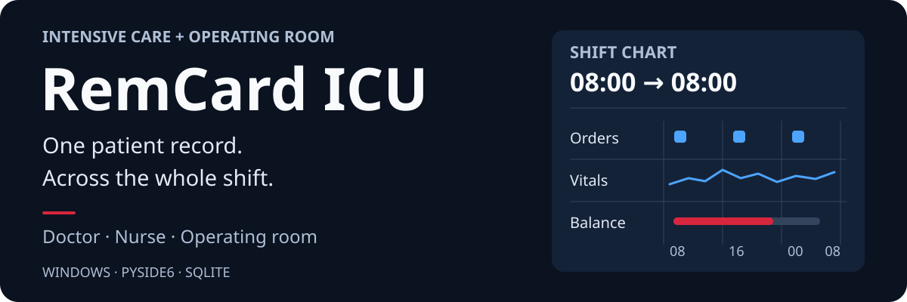

  <a href="README.md"><kbd><strong>English</strong> ✓</kbd></a>
  <a href="README.ru.md"><kbd>Русский</kbd></a>
  <a href="README.zh-CN.md"><kbd>中文（简体）</kbd></a>
  <a href="README.ja.md"><kbd>日本語</kbd></a>
  <a href="README.de.md"><kbd>Deutsch</kbd></a>

  

  <strong>Patient records and shared shift work for the ICU and operating room.</strong> 
  One Windows application for doctors, nurses, and planned and emergency OR teams.

  <a href="VERSION">v5.1.10</a> · Windows · Python 3.11 · PySide6 · SQLite 
  <a href="https://github.com/Donkiton/rem_card/releases">Releases</a> ·
  <a href="#read-more">Documentation</a> ·
  <a href="https://donkiton.github.io/rem_site/#english">Website</a> ·
  <a href="LICENSE">License</a>

> [!WARNING]
> **Experimental software, not a medical device.** Clinical use requires independent technical and clinical review, acceptance in the intended environment, and a backup workflow.

## Explore the interface

Demo patients · screenshots from **5.1.0** · interface in Russian. Expand a group to view images.

<strong>Workspaces and role selection</strong>

Four workspaces from a single entry point, with light and dark themes.

<strong>Patients, beds and admissions</strong>

Bed status, admissions and quick access to patient charts.

<strong>Medication orders and fluid balance</strong>

Orders, completion marks and fluid balance across the 08:00–08:00 shift.

## At a glance

- **Patient chart** — orders and administration, vital signs, fluid balance, ventilation, nutrition, procedures and laboratory results.
- **Team workflows** — doctor and nurse workspaces, planned and emergency operating rooms, and ICU–OR handover.
- **Clinical tools** — infusion, electrolyte and burn calculators, plus PDF reports.
- **Archive and analytics** — patient and surgical-case history, filters, comparisons and charts.

## Get started

For an installed build, launch **`RemCard.exe`** from the complete distribution folder, including `_internal`.

For source setup, data-folder selection and updates, follow the [setup guide](docs/guide/setup.en.md). Development and testing require a separate test database.

## Read more

| Guide | What you will find |
| --- | --- |
| [Features](docs/guide/features.en.md) | Workspaces, charting, nutrition, calculators and analytics. |
| [Setup and maintenance](docs/guide/setup.en.md) | Source setup, installation, updates, data safety and developer checks. |
| [Architecture](docs/guide/architecture.en.md) | Shared data, synchronization and the interactive code map. |

Detailed technical procedures are listed in the [documentation index](docs/README.md), primarily in Russian.

   
  Built by anaesthesiologist-intensivist Vadim Bityutsky · <a href="mailto:menfise@mail.ru">Contact</a>

