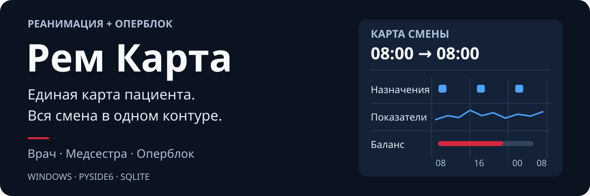

  <a href="README.md"><kbd>English</kbd></a>
  <a href="README.ru.md"><kbd><strong>Русский</strong> ✓</kbd></a>
  <a href="README.zh-CN.md"><kbd>中文（简体）</kbd></a>
  <a href="README.ja.md"><kbd>日本語</kbd></a>
  <a href="README.de.md"><kbd>Deutsch</kbd></a>

  

  <strong>Карта пациента и совместная работа смены в реанимации и оперблоке.</strong> 
  Одно Windows-приложение для врача, медсестры, плановой и экстренной операционной.

  <a href="VERSION">v5.1.10</a> · Windows · Python 3.11 · PySide6 · SQLite 
  <a href="https://github.com/Donkiton/rem_card/releases">Релизы</a> ·
  <a href="#что-почитать">Документация</a> ·
  <a href="https://donkiton.github.io/rem_site/">Сайт</a> ·
  <a href="LICENSE">Лицензия</a>

> [!WARNING]
> **Экспериментальный проект, не медицинское изделие.** Клиническое применение требует независимой технической и клинической проверки, приёмки в конкретной среде и резервного рабочего процесса.

## Посмотреть интерфейс

Демонстрационные пациенты · скриншоты **5.1.0** · интерфейс на русском. Раскройте нужную группу.

<strong>Рабочие места и выбор роли</strong>

Четыре рабочих места из единого окна, светлая и тёмная темы.

<strong>Пациенты, койки и поступления</strong>

Состояние коек, оформление поступления и быстрый переход к карте пациента.

<strong>Назначения и баланс жидкости</strong>

Назначения, отметки выполнения и баланс жидкости на шкале смены 08:00–08:00.

## Коротко о возможностях

- **Карта пациента** — назначения и выполнение, витальные показатели, баланс, ИВЛ, питание, процедуры и анализы.
- **Командная работа** — рабочие места врача и медсестры, плановый и экстренный оперблок, передача пациента из РАО.
- **Клинические инструменты** — расчёты инфузии, электролитов и ожогов, PDF-отчёты.
- **Архив и аналитика** — история пациентов и операций, фильтры, сравнения и графики.

## Начать работу

В установленной версии запустите **`RemCard.exe`** из полной папки поставки вместе с `_internal`.

Запуск из исходников, выбор папки данных и обновления описаны в [руководстве по запуску](docs/guide/setup.ru.md). Для разработки и испытаний нужна отдельная тестовая база.

## Что почитать

| Руководство | Содержание |
| --- | --- |
| [Возможности](docs/guide/features.ru.md) | Рабочие места, карта, питание, калькуляторы и аналитика. |
| [Запуск и обслуживание](docs/guide/setup.ru.md) | Исходники, установка, обновления, безопасность данных и проверки. |
| [Архитектура](docs/guide/architecture.ru.md) | Общие данные, синхронизация и интерактивная карта кода. |

Подробные технические регламенты собраны в [карте документации](docs/README.md).

   
  Автор — анестезиолог-реаниматолог Вадим Битюцкий · <a href="mailto:menfise@mail.ru">Связаться</a>

