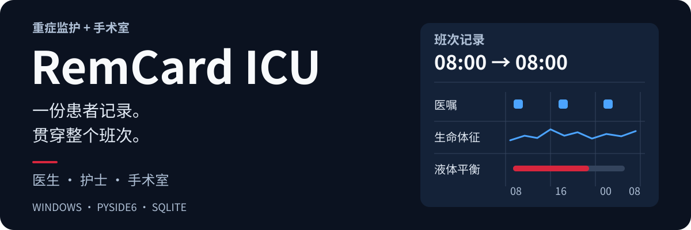

  <a href="README.md"><kbd>Русский</kbd></a>
  <a href="README.en.md"><kbd>English</kbd></a>
  <a href="README.zh-CN.md"><kbd><strong>中文（简体）</strong> ✓</kbd></a>
  <a href="README.ja.md"><kbd>日本語</kbd></a>
  <a href="README.de.md"><kbd>Deutsch</kbd></a>

  

  <strong>面向重症监护室与手术室的患者记录和班次协作。</strong> 
  一个 Windows 应用，供医生、护士、择期手术与急诊手术团队使用。

  <a href="VERSION">v5.1.10</a> · Windows · Python 3.11 · PySide6 · SQLite 
  <a href="https://github.com/Donkiton/rem_card/releases">发布版本</a> ·
  <a href="#进一步了解">使用文档</a> ·
  <a href="https://donkiton.github.io/rem_site/#english">项目网站</a> ·
  <a href="LICENSE">许可证</a>

> [!WARNING]
> **实验性软件，并非医疗器械。** 临床使用前，必须进行独立的技术与临床验证、目标环境验收，并准备备用工作流程。

## 浏览界面

演示患者 · **5.1.0** 版本截图 · 界面为俄语。展开分类即可查看图片。

<strong>工作界面与角色选择</strong>

统一入口提供四种工作界面，支持浅色与深色主题。

<strong>患者、床位与入院</strong>

查看床位状态、办理入院，并快速打开患者记录。

<strong>医嘱与液体平衡</strong>

查看 08:00 至次日 08:00 班次的医嘱、执行标记与液体平衡。

## 功能概览

- **患者记录** — 医嘱与给药执行、生命体征、液体平衡、机械通气、营养、医疗操作与检验结果。
- **团队协作** — 医生与护士工作界面、择期与急诊手术室，以及重症监护室与手术室之间的患者交接。
- **临床工具** — 输液、电解质与烧伤计算器，以及 PDF 报告。
- **归档与分析** — 患者与手术病例历史、筛选、比较和图表。

## 开始使用

使用已构建版本时，请从包含 `_internal` 的完整分发文件夹中启动 **`RemCard.exe`**。

从源码运行、选择数据文件夹和安装更新的步骤见[安装与维护指南](docs/guide/setup.zh-CN.md)。开发与测试必须使用独立的测试数据库。

## 进一步了解

| 指南 | 内容 |
| --- | --- |
| [功能](docs/guide/features.zh-CN.md) | 工作界面、患者记录、营养、计算器与分析。 |
| [安装与维护](docs/guide/setup.zh-CN.md) | 从源码运行、安装、更新、数据安全与开发者检查。 |
| [架构](docs/guide/architecture.zh-CN.md) | 共享数据、同步与交互式代码架构图。 |

详细技术规程见[文档索引](docs/README.md)，其中的文档主要为俄语。

   
  由麻醉与重症医学医师 Vadim Bityutsky 开发 · <a href="mailto:menfise@mail.ru">联系作者</a>

