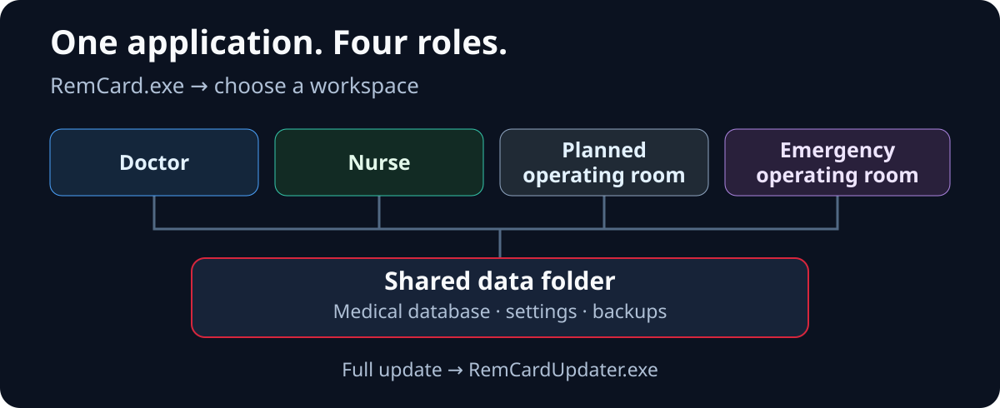

  <a href="architecture.ru.md"><kbd>Русский</kbd></a>
  <a href="architecture.en.md"><kbd><strong>English</strong> ✓</kbd></a>
  <a href="architecture.zh-CN.md"><kbd>中文（简体）</kbd></a>
  <a href="architecture.ja.md"><kbd>日本語</kbd></a>
  <a href="architecture.de.md"><kbd>Deutsch</kbd></a>

  <a href="../../README.en.md">← README</a> ·
  <a href="features.en.md">Features</a> ·
  <a href="setup.en.md">Setup</a>

# Architecture and synchronization

## How the shared workflow works

  

RemCard is a **PySide6** desktop application with a shared data folder. Routine workstation use does not require a separate web server. The main flow is **UI → services → DAO → SQLite**.

1. **Saving.** The interface submits changes to a write queue. The controller obtains a file lock and executes a transaction; a successful save is confirmed after `COMMIT` in the central database. A draft or queue entry alone does not mean the data is saved.
2. **Updating another workstation.** Triggers write notifications to `change_log` in the same transaction. `DataUpdateMonitor` detects changes, `SyncCoordinator` invalidates stale data, and the workstation rereads the required snapshot. Cache files are not transferred between computers.
3. **Fast reads.** `ReadCoordinator`, snapshots and local caching speed up display. The initial local replica is created through the SQLite Backup API, then small changes are applied to a separate local candidate. The candidate is checked and atomically replaces the previous copy; exceeding limits or encountering incompatibility triggers a full copy. The replica is read-only. If its version is behind the required version, reads switch to the central database. The central record after `COMMIT` remains the clinical source of truth.
4. **Responsiveness.** Snapshot loading, network writes, analytics and PDF generation use background tasks. Late results are checked before being applied to the open patient or selected period.

### Where the implementation lives

| Directory | Responsibility |
| --- | --- |
| [`ui/`](../../ui/) | Doctor and nurse workspaces, operating rooms, chart sectors, archives, procedures and UI settings. |
| [`services/`](../../services/) | Application operations, calculations, fluid balance, nutrition, read coordination and synchronization. |
| [`services/analytics/`](../../services/analytics/) | Metric registry, selections, cohorts, comparisons, statistics and chart data. |
| [`data/`](../../data/) | DAOs, models, reference catalogs and the separate settings database. |
| [`app/`](../../app/) | Startup and roles, paths, SQLite infrastructure, replicas, backups, emergency modes, logs and updates. |
| [`scripts/`](../../scripts/), [`tests/`](../../tests/) | Build and publication tools, CI, quality checks, automated tests and safety scenarios. |

The detailed [source-of-truth and synchronization contract](../source_of_truth_and_sync_contract.md) defines transaction boundaries, replica freshness and cache rules.

## Interactive architecture map

  <a href="https://donkiton.github.io/rem_card/codemap/codemap.html"><strong>Open the interactive RemCard map →</strong></a> 
  24 main modules · 48 verified connections · 6 end-to-end flows

The map was updated on **September 23, 2026** for the unified application architecture: `run_remcard.py` startup, role selection, database admission, background checks, session shutdown, the read replica and full updates. It is an overview of main components, rather than a list of every file; the source commit is shown on the map. Click a module to inspect its incoming and outgoing connections, related tests, source paths and supporting symbols. You can also select end-to-end scenarios, search components, filter module types, zoom and pan.

The map runs entirely in the browser and sends no data to an external server. Its verifiable source data is in [`codemap.json`](../codemap/codemap.json), with a standalone HTML version in [`codemap.html`](../codemap/codemap.html).
