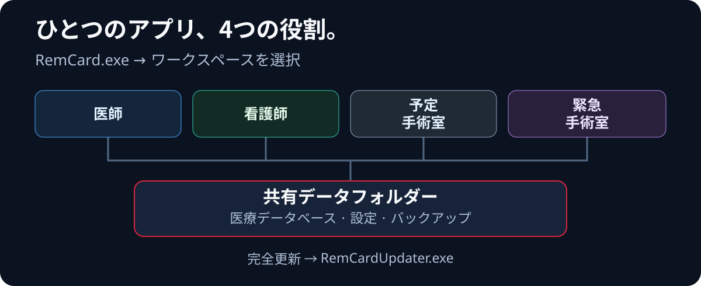

  <a href="architecture.en.md"><kbd>English</kbd></a>
  <a href="architecture.ru.md"><kbd>Русский</kbd></a>
  <a href="architecture.zh-CN.md"><kbd>中文（简体）</kbd></a>
  <a href="architecture.ja.md"><kbd><strong>日本語</strong> ✓</kbd></a>
  <a href="architecture.de.md"><kbd>Deutsch</kbd></a>

  <a href="../../README.ja.md">← README</a> ·
  <a href="features.ja.md">機能</a> ·
  <a href="setup.ja.md">起動</a>

# アーキテクチャと同期

## 統合ワークフローの仕組み

  

RemCardは、共通のデータフォルダーを使用する<strong>PySide6</strong>製のデスクトップアプリケーションです。端末での通常業務に、別途Webサーバーは必要ありません。基本的な処理の流れは、<strong>インターフェース → サービス → DAO → SQLite</strong>です。

1. <strong>保存。</strong> インターフェースは変更を書き込みキューに渡します。コントローラーはファイルロックを取得し、トランザクションを実行します。中央データベースでの`COMMIT`後に、保存の成功が確認されます。下書きやキューに入っただけでは、データが保存されたことにはなりません。
2. <strong>別の端末への反映。</strong> トリガーが同じトランザクション内で`change_log`に通知を記録します。`DataUpdateMonitor`が変更を検知し、`SyncCoordinator`が古いデータを無効化した後、端末が必要なスナップショットを再読み込みします。キャッシュファイルをコンピューター間で転送することはありません。
3. <strong>高速な読み取り。</strong> `ReadCoordinator`、スナップショット、ローカルキャッシュが表示を高速化します。最初のローカルレプリカはSQLite Backup APIで作成され、その後の小規模な変更は別のローカル候補コピーに適用されます。候補を検証してから既存コピーをアトミックに置き換えます。制限の超過や互換性の問題がある場合は完全コピーを行います。レプリカは読み取り専用です。必要なバージョンより古い場合は、読み取り先を中央データベースに切り替えます。臨床データの正本は、引き続き中央データベースで`COMMIT`された記録です。
4. <strong>応答性。</strong> スナップショットの読み込み、ネットワーク経由の書き込み、分析、PDF処理にはバックグラウンドタスクを使用します。遅れて届いた結果は、現在開いている患者や選択期間に適用する前に確認されます。

### 実装の配置

| ディレクトリ | 役割 |
| --- | --- |
| [`ui/`](../../ui/) | 医師・看護師の業務画面、手術室、患者記録の各セクター、アーカイブ、処置、画面設定。 |
| [`services/`](../../services/) | アプリケーションの操作、計算、水分出納、栄養、読み取りと同期の調整。 |
| [`services/analytics/`](../../services/analytics/) | 指標レジストリ、データ抽出、コホート、比較、統計、グラフ用データ。 |
| [`data/`](../../data/) | DAO、モデル、マスターデータ、独立した設定データベース。 |
| [`app/`](../../app/) | 起動と役割、パス、SQLite基盤、レプリカ、バックアップ、緊急モード、ログ、更新。 |
| [`scripts/`](../../scripts/)、[`tests/`](../../tests/) | ビルドと配布、CI、品質チェック、自動テスト、安全性シナリオ。 |

詳細な[正本と同期の契約](../source_of_truth_and_sync_contract.md)では、トランザクションの境界、レプリカの鮮度、キャッシュの規則を説明しています。

## インタラクティブなアーキテクチャマップ

  <a href="https://donkiton.github.io/rem_card/codemap/codemap.html"><strong>RemCardのインタラクティブマップを開く →</strong></a> 
  主要モジュール24個 · 確認済みの関連48本 · 横断的な処理フロー6本

このマップは、統合アプリケーションのアーキテクチャに合わせて<strong>2026年9月23日</strong>に更新されました。`run_remcard.py`による起動、役割選択、データベースへのアクセス許可、バックグラウンド確認、セッション終了、読み取りレプリカ、完全更新を扱います。主要コンポーネントの概要であり、すべてのファイルを列挙したものではありません。基準としたコミットはマップ自体に記載されています。モジュールをクリックすると、入力・出力の関係、関連テスト、ソースパス、裏付けとなるシンボルを確認できます。横断的なシナリオの選択、コンポーネント検索、モジュール種別による絞り込み、拡大縮小、図のドラッグにも対応しています。

マップはすべてブラウザー内で動作し、外部サーバーへデータを送信しません。検証可能な元データは[`codemap.json`](../codemap/codemap.json)、単体で動作するHTML版は[`codemap.html`](../codemap/codemap.html)で確認できます。
