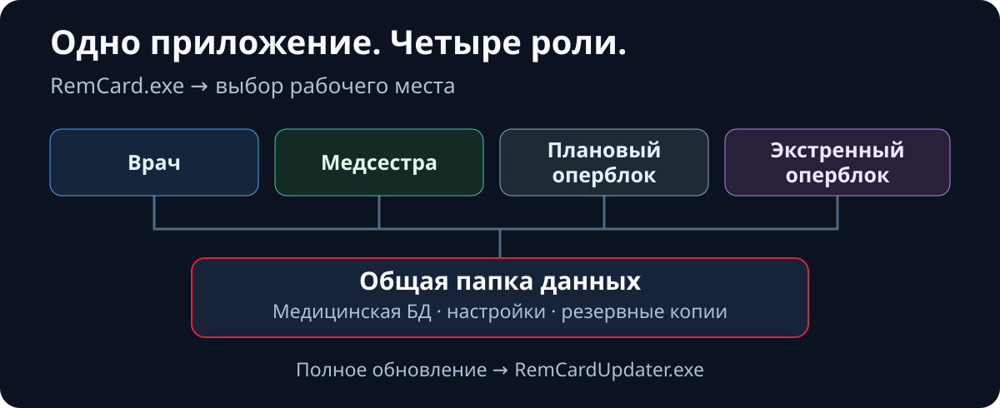

  <a href="architecture.en.md"><kbd>English</kbd></a>
  <a href="architecture.ru.md"><kbd><strong>Русский</strong> ✓</kbd></a>
  <a href="architecture.zh-CN.md"><kbd>中文（简体）</kbd></a>
  <a href="architecture.ja.md"><kbd>日本語</kbd></a>
  <a href="architecture.de.md"><kbd>Deutsch</kbd></a>

  <a href="../../README.ru.md">← README</a> ·
  <a href="features.ru.md">Возможности</a> ·
  <a href="setup.ru.md">Запуск</a>

# Архитектура и синхронизация

## Как устроен общий контур

  

RemCard — настольное приложение на **PySide6** с общей папкой данных. Для штатной работы рабочих мест отдельный веб-сервер не требуется. Основной поток — **интерфейс → сервисы → DAO → SQLite**.

1. **Сохранение.** Интерфейс передаёт изменение в очередь записи. Контроллер получает файловую блокировку и выполняет транзакцию; успешное сохранение подтверждается после `COMMIT` в центральной БД. Черновик или очередь сами по себе не означают, что данные сохранены.
2. **Обновление другого рабочего места.** Триггеры записывают уведомления в `change_log` в той же транзакции. `DataUpdateMonitor` обнаруживает изменения, `SyncCoordinator` сбрасывает устаревшие данные, после чего рабочее место перечитывает нужный снимок. Файлы кэша между компьютерами не передаются.
3. **Быстрое чтение.** `ReadCoordinator`, снимки и локальный кэш ускоряют отображение. Первая локальная реплика создаётся через SQLite Backup API, затем небольшие изменения применяются к отдельному локальному кандидату. Кандидат проверяется и атомарно заменяет прежнюю копию; при превышении ограничений или несовместимости выполняется полное копирование. Реплика служит только для чтения. Если её версия отстаёт от необходимой, чтение переключается на центральную БД. Источником клинической истины остаётся центральная запись после `COMMIT`.
4. **Отзывчивость.** Загрузка снимков, сетевые записи, аналитика и PDF используют фоновые задачи. Поздние результаты проверяются перед применением к открытому пациенту или выбранному периоду.

### Где находится реализация

| Каталог | Ответственность |
| --- | --- |
| [`ui/`](../../ui/) | Рабочие места врача и медсестры, оперблок, секторы карты, архив, процедуры и настройки интерфейса. |
| [`services/`](../../services/) | Прикладные операции, расчёты, баланс, питание, координация чтения и синхронизации. |
| [`services/analytics/`](../../services/analytics/) | Реестр метрик, выборки, когорты, сравнения, статистика и данные графиков. |
| [`data/`](../../data/) | DAO, модели, справочники и отдельная БД настроек. |
| [`app/`](../../app/) | Запуск и роли, пути, SQLite-инфраструктура, реплика, резервирование, аварийные режимы, логи и обновления. |
| [`scripts/`](../../scripts/), [`tests/`](../../tests/) | Сборка и публикация, CI, проверки качества, автоматические тесты и safety-сценарии. |

Подробный [контракт источника истины и синхронизации](../source_of_truth_and_sync_contract.md) описывает границы транзакций, свежесть реплики и правила кэша.

## Интерактивная карта архитектуры

  <a href="https://donkiton.github.io/rem_card/codemap/codemap.html"><strong>Открыть интерактивную карту RemCard →</strong></a> 
  24 основных модуля · 48 подтверждённых связей · 6 сквозных потоков

Карта обновлена **23 сентября 2026 года** для архитектуры единого приложения: запуск `run_remcard.py`, выбор роли, допуск к базе, фоновая проверка, завершение сессии, реплика чтения и полное обновление. Это обзор основных компонентов, а не перечень каждого файла; исходный коммит указан на самой карте. Нажмите на модуль, чтобы увидеть его входящие и исходящие связи, связанные тесты, исходные пути и подтверждающие символы. Отдельно можно выбирать сквозные сценарии, искать компоненты, фильтровать типы модулей, масштабировать и перетаскивать схему.

Карта полностью выполняется в браузере и не отправляет данные на внешний сервер. Её проверяемые исходные данные доступны в [`codemap.json`](../codemap/codemap.json), а автономная HTML-версия — в [`codemap.html`](../codemap/codemap.html).
