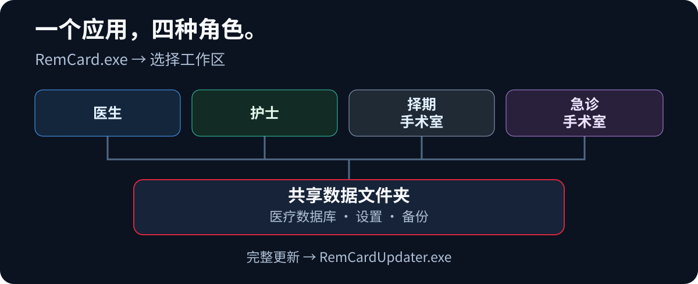

  <a href="architecture.en.md"><kbd>English</kbd></a>
  <a href="architecture.ru.md"><kbd>Русский</kbd></a>
  <a href="architecture.zh-CN.md"><kbd><strong>中文（简体）</strong> ✓</kbd></a>
  <a href="architecture.ja.md"><kbd>日本語</kbd></a>
  <a href="architecture.de.md"><kbd>Deutsch</kbd></a>

  <a href="../../README.zh-CN.md">← README</a> ·
  <a href="features.zh-CN.md">功能</a> ·
  <a href="setup.zh-CN.md">启动</a>

# 架构与同步

## 协同工作架构

  

RemCard 是基于 <strong>PySide6</strong> 的桌面应用，使用共享数据文件夹。工作站常规使用不需要单独的 Web 服务器。主要数据流为<strong>界面 → 服务 → DAO → SQLite</strong>。

1. <strong>保存。</strong> 界面将变更提交到写入队列。控制器取得文件锁并执行事务；只有中央数据库完成 `COMMIT` 后，才会确认保存成功。草稿或排队本身并不意味着数据已保存。
2. <strong>更新其他工作站。</strong> 触发器在同一事务中将通知写入 `change_log`。`DataUpdateMonitor` 检测变更，`SyncCoordinator` 使过期数据失效，随后工作站重新读取所需快照。计算机之间不传输缓存文件。
3. <strong>快速读取。</strong> `ReadCoordinator`、快照和本地缓存加快显示。首次本地副本通过 SQLite Backup API 创建，之后将少量变更应用于另一个本地候选副本。候选副本通过检查后，以原子方式替换旧副本；超出限制或不兼容时，执行完整复制。副本仅用于读取。如果其版本低于所需版本，读取将切换至中央数据库。中央数据库完成 `COMMIT` 后的记录始终是临床数据的权威来源。
4. <strong>响应速度。</strong> 快照加载、网络写入、分析和 PDF 生成均使用后台任务。延迟返回的结果在应用于当前打开的患者或所选时段前会经过检查。

### 实现位置

| 目录 | 职责 |
| --- | --- |
| [`ui/`](../../ui/) | 医生与护士工作界面、手术室、患者记录各区、归档、医疗操作和界面设置。 |
| [`services/`](../../services/) | 应用操作、计算、液体平衡、营养，以及读取与同步协调。 |
| [`services/analytics/`](../../services/analytics/) | 指标注册表、数据选取、队列、比较、统计与图表数据。 |
| [`data/`](../../data/) | DAO、模型、基础数据目录和独立设置数据库。 |
| [`app/`](../../app/) | 启动与角色、路径、SQLite 基础设施、副本、备份、应急模式、日志与更新。 |
| [`scripts/`](../../scripts/), [`tests/`](../../tests/) | 构建与发布、CI、质量检查、自动化测试和安全性场景。 |

详细的[权威数据源与同步契约](../source_of_truth_and_sync_contract.md)说明了事务边界、副本时效和缓存规则。

## 交互式架构图

  <a href="https://donkiton.github.io/rem_card/codemap/codemap.html"><strong>打开 RemCard 交互式架构图 →</strong></a> 
  24 个主要模块 · 48 条已验证的关系 · 6 条端到端流程

架构图于 <strong>2026 年 9 月 23 日</strong>更新，反映统一应用架构：`run_remcard.py` 启动、角色选择、数据库准入、后台检查、会话结束、读取副本和完整更新。它概览主要组件，并非列出每个文件；对应的源码提交标注在图中。点击模块可查看其传入和传出关系、相关测试、源码路径以及作为依据的代码符号。还可以选择端到端场景、搜索组件、筛选模块类型、缩放与拖动图形。

架构图完全在浏览器中运行，不向外部服务器发送数据。可核验的原始数据见 [`codemap.json`](../codemap/codemap.json)，独立 HTML 版本见 [`codemap.html`](../codemap/codemap.html)。
